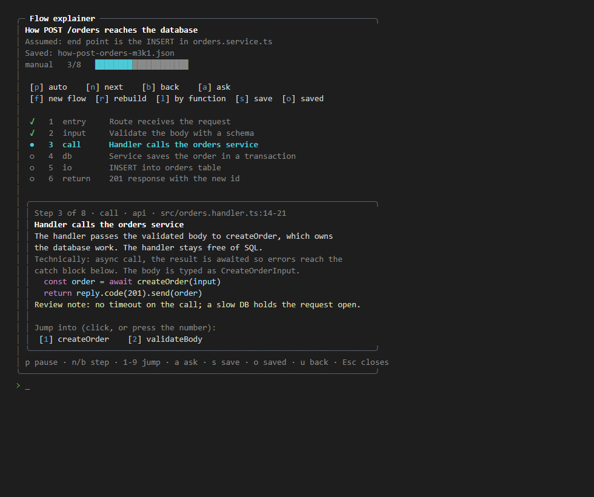

# flow-explainer-mod

`/flow` and `/flow-explain` turn a scenario, a question, or a diff into a guided walk through the code, one step at a time. It's for reviewing AI-written or unfamiliar code faster, and for juniors who want a tutor to walk them through a codebase.



*The pane's layout with a sample flow (`POST /orders`). The image is a mockup of the layout, not a live capture.*

```
/flow how does POST /orders reach the database?
/flow-explain explain the diff of this MR and why it works like this
/flow --lines trace where the auth token is checked --pace=4
/flow                       # opens the pane and asks for a scenario
/flow-resume                # pick a saved flow
/flow-resume orders         # reopen the first saved flow whose name or title contains "orders"
```

## Save and resume

Press `s` to save a flow. It's written to `~/.claude/flow-explainer/saved/<title>-<id>.json`, with the step you're on. Saving again updates the same file. Saved flows are plain JSON, so you can commit them, send them to a teammate, or review them later. A resumed flow opens on its saved step, in manual mode.

## How it works

1. The command opens a pane and sends a prompt to the **main session**. Claude builds the flow with its normal tools, so it uses the **currently selected model and thinking effort**.
2. Claude follows the real execution path: entry, calls, transforms, branches, I/O, and the end point. It checks each step against the language's best practices and the project's rules (CLAUDE.md, `.claude/` rules and skills, lint config). It reads git for diffs and follows symlinks or linked workspaces into other repos (for example, a database project linked into a backend).
3. Claude writes the flow as JSON to `~/.claude/flow-explainer/flows/<id>.json`, outside the project, so nothing lands in your repo.
4. When that turn completes, the pane reads the file and draws it: a vertical list of steps with the current one highlighted, and a detail panel with the plain-language explanation, the technical detail, the code, and any review note.

**End points.** If the request names no end, Claude assumes one and lists the assumption at the top of the pane. Frontend: the UI element that renders the data. Backend: the HTTP response, a database write, or the call that leaves the codebase.

## Controls

| Key | Action |
|---|---|
| `p` | switch auto progress on or off. Off by default: you step with `n` and `b` |
| `n` / `b` | next / back step |
| `a` | ask a question about the current step; the answer comes back in the main chat |
| `f` | new flow from a scenario |
| `r` | rebuild the last request (use after `l` to change granularity) |
| `l` | toggle the granularity for the next flow: by function or line by line |
| `c` | cancel a flow that is still being built |
| `s` | save the flow and the step you're on |
| `o` | pick a saved flow to resume (`q` goes back) |
| `1`-`9` (or click) | jump into a call from the current step as a sub-flow |
| `u` | back to the flow you jumped from |
| `Esc` | close the pane |

Space is not used: Claude Code's pane hotkeys accept only a digit or a lowercase letter, so `p` pauses. Keys work when the pane has focus (open with `/flow`, or Ctrl+X then Tab).

## Keeping saved flows up to date

When a saved flow is resumed, the mod compares a SHA-256 digest of each step's file with the digest saved with the flow. If any file changed, appeared, or disappeared, Claude updates the saved flow first: it re-reads the changed files, fixes line numbers, rewrites or removes steps that changed, and adds steps for new logic. Then the flow opens at the step you saved on, and the file is saved again with new digests. Unchanged flows open straight away. Flows saved before this check existed are re-checked once.

Digests cover the files of each step under the folder the flow was saved from. A step in another linked repo is checked only if its file path also exists there.

## Jumping into a call

When Claude builds a flow, each step can list the calls it makes that have definitions in this codebase. Those calls appear under the step as numbered buttons. Click one, or press its digit, and the mod opens a sub-flow that starts at that definition. The parent flow stays in memory: press `u` to return to it at the same step. Jumps aren't saved, but the flow you jumped from can be saved as usual.

## Flags

- `--lines`: one step per statement, instead of per function.
- `--functions`: one step per function (the default).
- `--pace=N`: seconds per step in auto mode (minimum 2, default 6). Auto mode is off unless you press `p`.

## Requirements

- Claude Code v2.1.287 or later.
- Built and tested on Windows. Path and platform handling covers macOS too, but macOS is not yet tested. The flow is built by Claude, so no extra API key is needed.

## What the mod does (for reviewers)

- Reads its own flow files and checks they exist: `$.fs.exists`, `$.fs.read` (only under `~/.claude/flow-explainer/flows/`).
- Reads the home folder and OS to build that path: `$.env.get` (`USERPROFILE`, `HOME`, `OS`), `$.session.cwd`.
- Starts a turn in the main session with the built prompt or a question about a step: `$.prompt.submit`. A timer sends it, since a command hook can't start a turn.
- Draws the pane and status, and shows a toast if the pane can't be placed: `$.ui.*`, `$.command.register`, `$.clock.every`.
- No network, no processes, no writes, no shell.

## Load it

PowerShell:

```powershell
claude --plugin-dir "D:\Projects\Projects\claude-plugins\flow-explainer-mod"
claude plugin validate "D:\Projects\Projects\claude-plugins\flow-explainer-mod"
Set-Location "D:\Projects\Projects\claude-plugins\flow-explainer-mod"; claude plugin test
```

Bash / Zsh:

```bash
claude --plugin-dir ~/mods/flow-explainer-mod
claude plugin validate ~/mods/flow-explainer-mod
cd ~/mods/flow-explainer-mod && claude plugin test
```

Git Bash rewrites slash commands. Run `claude -p "/flow"` from PowerShell, or prefix it with `MSYS_NO_PATHCONV=1`.

## Tests

`claude plugin test` runs `tests/flow-explainer.test.ts`: the build prompt for `/flow` and `--lines`, Windows and POSIX file paths, a finished flow drawn on both surfaces, the auto-advance timer, an aborted turn, and the bare `/flow` input.

Tested on Claude Code 2.1.296.
