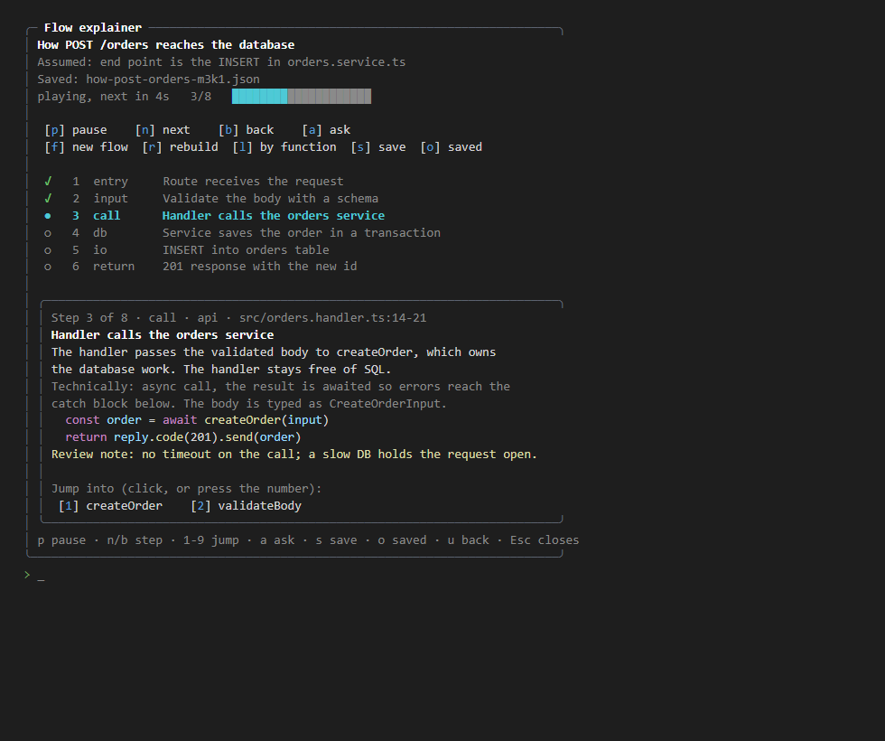

# Flow Explainer

`/flow` and `/flow-explain` turn a scenario, a question, or a diff into a guided walk through the code, one step at a time. It's for reviewing AI-written or unfamiliar code faster, and for juniors who want a tutor to walk them through a codebase.

> **Claude Code only.** Runs in the Claude Code CLI (v2.1.287+), the Desktop app's Code tab (v2.1.286+) and the VS Code extension (v2.1.299+ for panes). It does nothing in claude.ai chat or Cowork.



*The pane's layout with a sample flow (`POST /orders`). The image is a mockup of the layout, not a live capture.*

## Install

This repo is a Claude Code plugin marketplace. In Claude Code, add the marketplace, then install the plugin from it:

```
/plugin marketplace add netgfx/claude-flow-explainer
/plugin install powermods-flow-explainer@flow-explainer
```

Or do both in one step (Claude Code v2.1.275 or later):

```
/plugin install powermods-flow-explainer --marketplace netgfx/claude-flow-explainer
```

From a terminal, the same steps are `claude plugin marketplace add netgfx/claude-flow-explainer` and `claude plugin install powermods-flow-explainer@flow-explainer`. To get new versions later, run `/plugin marketplace update flow-explainer`.

**Upgrading from `flow-explainer-mod`.** The plugin was renamed from `flow-explainer-mod` to `powermods-flow-explainer` in 0.3.0. The marketplace's `renames` entry moves existing installs to the new name. If Claude Code then reports that the plugin isn't cached, run `/plugin install powermods-flow-explainer@flow-explainer` once. Saved flows are kept: they live in `~/.claude/flow-explainer`, which doesn't depend on the plugin name.

### Requirements

- Claude Code v2.1.287 or later (Desktop Code tab v2.1.286 or later).
- Built and tested on Windows. Path and platform handling covers macOS and Linux too, and the tests run on Windows and Linux. The flow is built by Claude in your session, so no extra API key is needed.

## Usage

```
/flow how does POST /orders reach the database?
/flow-explain explain the diff of this MR and why it works like this
/flow --lines trace where the auth token is checked --pace=4
/flow                       # opens the pane and asks for a scenario
/flow-resume                # pick a saved flow
/flow-resume orders         # reopen the first saved flow whose name or title contains "orders"
```

## Save and resume

Press `s` to save a flow. It's written to `~/.claude/flow-explainer/saved/<title>-<id>.json`, with the step you're on. Saving again updates the same file. Saved flows are plain JSON, so you can commit them, send them to a teammate, or review them later. A resumed flow opens on its saved step, in manual mode.

## How it works

1. The command opens a pane and sends a prompt to the **main session**. Claude builds the flow with its normal tools, so it uses the **currently selected model and thinking effort**.
2. Claude follows the real execution path: entry, calls, transforms, branches, I/O, and the end point. It checks each step against the language's best practices and the project's rules (CLAUDE.md, `.claude/` rules and skills, lint config). It reads git for diffs and follows symlinks or linked workspaces into other repos (for example, a database project linked into a backend).
3. Claude writes the flow as JSON to `~/.claude/flow-explainer/flows/<id>.json`, outside the project, so nothing lands in your repo.
4. When that turn completes, the pane reads the file and draws it: a vertical list of steps with the current one highlighted, and a detail panel with the plain-language explanation, the technical detail, the code, and any review note.

**End points.** If the request names no end, Claude assumes one and lists the assumption at the top of the pane. Frontend: the UI element that renders the data. Backend: the HTTP response, a database write, or the call that leaves the codebase.

## Controls

| Key | Action |
|---|---|
| `p` | switch auto progress on or off. Off by default: you step with `n` and `b` |
| `n` / `b` | next / back step |
| `a` | ask a question about the current step; the answer comes back in the main chat |
| `f` | new flow from a scenario |
| `r` | rebuild the last request (use after `l` to change granularity) |
| `l` | toggle the granularity for the next flow: by function or line by line |
| `c` | cancel a flow that is still being built |
| `s` | save the flow and the step you're on |
| `o` | pick a saved flow to resume (`q` goes back) |
| `1`-`9` (or click) | jump into a call from the current step as a sub-flow |
| `u` | back to the flow you jumped from |
| `Esc` | close the pane |

Space is not used: Claude Code's pane hotkeys accept only a digit or a lowercase letter, so `p` pauses. Keys work when the pane has focus (open with `/flow`, or Ctrl+X then Tab).

## Keeping saved flows up to date

When a saved flow is resumed, the mod compares a SHA-256 digest of each step's file with the digest saved with the flow. If any file changed, appeared, or disappeared, Claude updates the saved flow first: it re-reads the changed files, fixes line numbers, rewrites or removes steps that changed, and adds steps for new logic. Then the flow opens at the step you saved on, and the file is saved again with new digests. Unchanged flows open straight away. Flows saved before this check existed are re-checked once.

Digests cover the files of each step under the folder the flow was saved from. A step in another linked repo is checked only if its file path also exists there.

## Jumping into a call

When Claude builds a flow, each step can list the calls it makes that have definitions in this codebase. Those calls appear under the step as numbered buttons. Click one, or press its digit, and the mod opens a sub-flow that starts at that definition. The parent flow stays in memory: press `u` to return to it at the same step. Jumps aren't saved, but the flow you jumped from can be saved as usual.

## Flags

- `--lines`: one step per statement, instead of per function.
- `--functions`: one step per function (the default).
- `--pace=N`: seconds per step in auto mode (minimum 2, default 6). Auto mode is off unless you press `p`.

## Data, network and permissions

Everything stays on your machine. See [PRIVACY.md](PRIVACY.md) for the privacy statement.

In short, for the directory's checks:

- **Files it writes:** only saved flows, as JSON, at `~/.claude/flow-explainer/saved/<title>-<id>.json`. The path is your home folder, the fixed folders `.claude/flow-explainer/saved`, the flow's title reduced to `a-z`, `0-9` and `-`, a time-based id and `.json`; or the same saved file again when you save or update a flow you resumed. It never writes inside your project, and none of these files is a build, start-up, settings or instructions file.
- **What it puts in prompts it submits:** three kinds of prompt, each starting with `[flow-explainer]`, sent with `$.prompt.submit` into your own session (not as your words, and only after a `/flow`, `/flow-explain` or `/flow-resume` command or a key in the pane):
  - *Build a flow* (`buildPrompt`): the request you typed, the granularity (by function or line by line), fixed instructions to trace the code read-only and follow linked folders, the path of the flow file to write under `~/.claude/flow-explainer/flows/`, and the JSON shape to write.
  - *Update a saved flow* (`buildUpdatePrompt`): the saved flow's title and original request, the relative paths of the files that changed since it was saved, the saved file's path, fixed update instructions and the JSON shape.
  - *Ask about a step* (`askAboutStep`): the flow's title, the step's number, title and location, the step's plain-language explanation, and the question you typed.
  No file contents, environment values or other data go into these prompts. Claude reads your code itself, with its normal tools.
- **Programs it runs:** none.
- **Hosts it contacts:** none.
- **Hooks:**
  - `session.start`: registers `/flow`, `/flow-explain` and `/flow-resume`, and starts the one-second timer that sends a queued prompt and advances auto mode. Changes nothing.
  - `command.run` for `/flow`, `/flow-explain` and `/flow-resume`: answers the mod's own commands. Changes nothing else.
  - `turn.complete`: when a flow is being built, reads the flow file Claude wrote. Passes the event on unchanged.
  - `ui.render` for its own pane: draws the pane. Leaves every other drawing alone.

**Files it reads and writes**

- Writes saved flows to `~/.claude/flow-explainer/saved/<title>-<id>.json` when you press `s`, and again after a resumed flow is updated (`saveFlow` in `hooks/register.js`). A saved flow holds the flow's steps, the step you were on, the project folder it was saved from, and a SHA-256 digest of each step's file.
- Reads the flow files in `~/.claude/flow-explainer/flows/` that Claude writes for each build, and lists and reads `~/.claude/flow-explainer/saved/` for `/flow-resume` and the `o` picker.
- Reads the project files a saved flow's steps point to, only to compare their SHA-256 digests when you save or resume a flow. File contents are not stored, only the digests.
- Reads the environment variables `USERPROFILE`, `HOME` and `OS`, and the session's working folder, to build those paths.
- These folders are outside your project, so nothing lands in your repo. To delete everything the mod keeps, delete the `~/.claude/flow-explainer` folder.

**What it sends to Claude**

- `/flow`, `/flow-explain`, `/flow-resume` and the pane's keys (`f` new flow, `r` rebuild, `a` ask, `1`-`9` jump into a call, picking a saved flow whose code changed) queue one prompt, which a one-second timer sends to the main session with `$.prompt.submit`. A command hook can't start a turn itself, which is why a timer sends it. Nothing is sent without one of those actions.
- The prompt is not sent as your own words: Claude Code tells Claude it comes from this mod. It runs as a normal turn with your current model and effort, on your own Claude plan or API key.
- The prompts are built in `hooks/register.js`: `buildPrompt` (build a flow), `buildUpdatePrompt` (update a saved flow whose code changed) and `askAboutStep` (a question about one step). Each one starts with `[flow-explainer]` and tells Claude to work read-only: not to edit project files and not to run commands that change state. The one file Claude is asked to write is the flow file under `~/.claude/flow-explainer`.
- The build prompt asks Claude to read git (`git diff`, `git log`, `git show`) for a diff, and to follow symlinks, linked folders and additional workspaces into other projects, for example a database project linked into a backend. If you link private repos into a project, Claude may read them while it builds the flow. Claude does this with its normal tools, under your permission settings.

**What it doesn't do**

- No network calls: `network.hosts` in `plugin.json` is empty.
- Starts no programs and runs no shell.
- Doesn't watch, approve, deny or change tool calls, and doesn't change your prompts or the system prompt.
- Keeps nothing in `$.store`, sets no environment variables and reads no settings.

**Hooks it registers:** `session.start` (registers the three commands and the timer), `command.run` for `/flow`, `/flow-explain` and `/flow-resume`, `turn.complete` (reads the flow file when the turn that builds it ends) and `ui.render` for its own pane.

## Load from a local checkout

For development, load the plugin straight from a clone instead of installing it. PowerShell:

```powershell
claude --plugin-dir .\claude-flow-explainer
claude plugin validate .\claude-flow-explainer
Set-Location .\claude-flow-explainer; claude plugin test
```

Bash / Zsh:

```bash
claude --plugin-dir ~/mods/claude-flow-explainer
claude plugin validate ~/mods/claude-flow-explainer
cd ~/mods/claude-flow-explainer && claude plugin test
```

Git Bash rewrites slash commands. Run `claude -p "/flow"` from PowerShell, or prefix it with `MSYS_NO_PATHCONV=1`.

## Tests

`claude plugin test` runs `tests/flow-explainer.test.ts`: the build prompt for `/flow` and `--lines`, a finished flow drawn on both surfaces, the auto-advance timer, an aborted turn, the bare `/flow` input, saving, resuming, the change check on resume, and jumping into a call. Each test runs twice, with Windows paths and with POSIX paths, and the suite passes on Windows and Linux. CI runs it on both, together with `claude plugin validate --profile directory --strict`.

Tested on Claude Code 2.1.331.

## License

[MIT](LICENSE)
